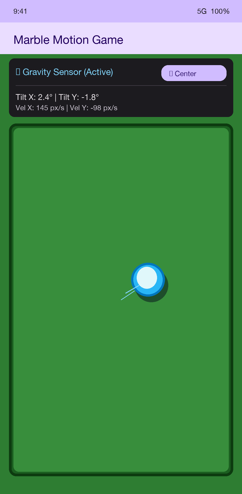

# Assignment 5: Marble Game (Fun with Sensors)

An Android application built with Jetpack Compose that simulates a marble rolling around the screen in response to device orientation using motion sensors.

---

## Technical Features

1. **Sensor Framework API Integration:**
   - Primary sensor: `Sensor.TYPE_GRAVITY` (Clean gravity vector components).
   - Fallback sensor: `Sensor.TYPE_ACCELEROMETER` with low-pass filtering for emulators and devices lacking gravity hardware.
   - Sensor lifecycle: Listens with `SensorManager.SENSOR_DELAY_GAME` in `onResume()` and unregisters in `onPause()` to conserve device resources.

2. **Real-time Physics & Boundary Clamping:**
   - Converts device tilt to acceleration (`ax`, `ay`).
   - Inverts Y axis coordinate system to align Android sensor Y (upwards) with Compose layout `offset` Y (downwards).
   - Implements natural friction damping (`0.94f`) for smooth deceleration.
   - Screen collision detection: clamps marble strictly within `0 <= x <= screenWidth - marbleSize` and `0 <= y <= screenHeight - marbleSize`.

3. **MVVM Architecture:**
   - `MarbleState` (Model) -> `MarbleViewModel` (`StateFlow`) -> `MarbleGameScreen` (Compose UI).
   - Container layout uses `BoxWithConstraints` to dynamically measure container dimensions.

---

## Screenshots

