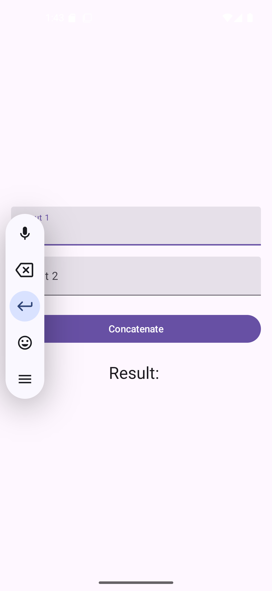

# Lecture 15 In-Class Practice: Gemini AI Text Summarizer

An Android application built with Jetpack Compose and the Google Generative AI SDK (`com.google.ai.client.generativeai:generativeai`) using `gemini-3.5-flash` to summarize long form text.

Project Location: [`../TextSummarizerDemoV2`](../TextSummarizerDemoV2)

---

## Features & Implementation

1. **Google Gemini 3.5 Integration:**
   - Uses `GenerativeModel(modelName = "gemini-3.5-flash", apiKey = key)` to process text summarization requests.
   - Summarizes user input into clear, concise bullet points or short paragraphs.

2. **API Key Security & Configuration:**
   - Supports secure key loading via `secrets.properties` (`GEMINI_API_KEY=your_key_here`), mapped to `BuildConfig.GEMINI_API_KEY`.
   - Includes an in-app input field for pasting an API key directly on device.

3. **Compose Material 3 UI:**
   - Real-time word and character counters.
   - Loading progress indicator during model generation.
   - Output summary card with a one-tap copy-to-clipboard button.

---

## Text Summarization Demonstration

### Before (Original Text):
> "Artificial intelligence (AI) is intelligence demonstrated by machines, in contrast to the natural intelligence displayed by humans and animals. Leading AI textbooks define the field as the study of 'intelligent agents': any system that perceives its environment and takes actions that maximize its chance of achieving its goals. As machines become increasingly capable, tasks considered to require 'intelligence' are often removed from the definition of AI, a phenomenon known as the AI effect."

### After (Gemini 3.5 AI Summary):
> - **AI Definition:** Machine-demonstrated intelligence focused on studying intelligent agents that perceive environments and act to achieve goals.
> - **AI Effect:** As technologies become routine, they are often no longer categorized as AI.

---

## Working App Screenshots

